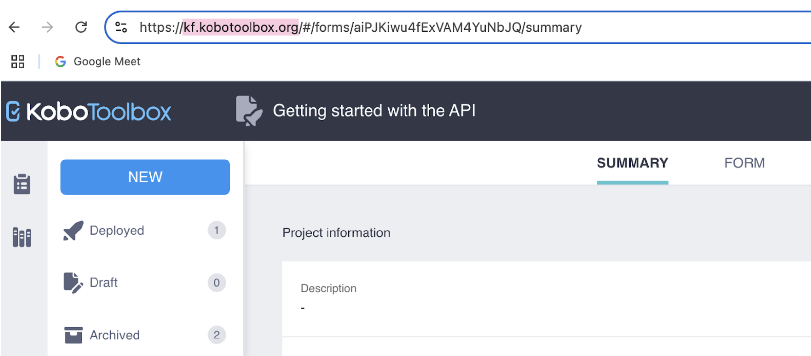
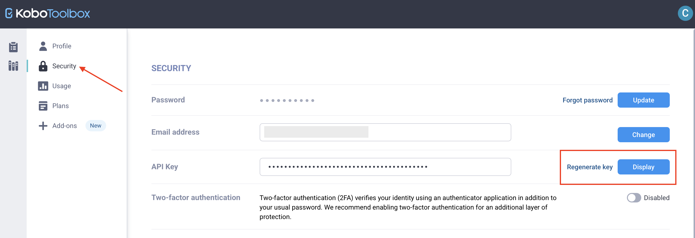
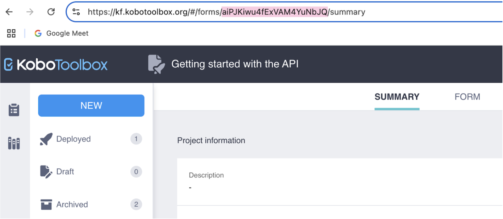

# Getting started with the API
**Last updated:** <a href="https://github.com/kobotoolbox/docs/blob/afd562326337a448c613f919951aaed8005b62ef/source/api.md" class="reference">22 Jun 2026</a>

An **Application Programming Interface (API)** allows different software applications to communicate and share information. The **KoboToolbox API** lets you connect KoboToolbox to external tools and automate tasks without using the web interface.

For example, you can use the API to automatically retrieve updated project data for dashboards, reports, or backups, without manually downloading files each time.

With the KoboToolbox API, you can:

* **Access and download data** in formats such as JSON, CSV, or XLSX.
* **Automate data exports** to keep dashboards, reports, and backups up to date.
* **Submit or edit records** from external applications.
* **Create, deploy, or duplicate** projects using scripts.
* **Manage users and project permissions** through external tools.

This article introduces the KoboToolbox API. It covers finding your server URL, API key, and project asset UID, exporting project data using the API, and accessing advanced API documentation.

## Connecting to your data through the API

The KoboToolbox API uses web addresses called **API endpoints** to access specific information or perform actions in KoboToolbox.

There are two main ways to access submission data through the API:

* **Synchronous exports:** Allow you to retrieve project data in XLSX or CSV format using [saved export settings](https://support.kobotoolbox.org/advanced_export.html#saving-export-settings) through the **exports endpoint**. This method is easier to set up and suitable for most small and medium-sized projects.
* **Data endpoint:** Provides more flexible access to submission data but requires additional technical knowledge to manage authentication and pagination. This method is better suited to large or complex datasets that require more control over how data is retrieved.

For most users, **synchronous exports** are the recommended starting point.

    For more information about synchronous exports, see <a href="https://support.kobotoolbox.org/synchronous_exports.html">Using the API for synchronous exports</a>. 

## Accessing the KoboToolbox API

To access the data endpoint and other KoboToolbox API endpoints, you will typically need your **server URL, API key,** and **project asset UID**. These details allow external applications to connect to your KoboToolbox server, authenticate requests, and access data from a specific project.

### Retrieving your server URL
The **server URL** is the base web address of your KoboToolbox server. It is used at the beginning of every API request and depends on the server where you [created your account](https://support.kobotoolbox.org/creating_account.html).

| Server                            | URL                                                                      |
| :-------------------------------- | :----------------------------------------------------------------------- |
| Global KoboToolbox Server         | [kf.kobotoolbox.org](https://kf.kobotoolbox.org/) |
| European Union KoboToolbox Server | [eu.kobotoolbox.org](https://eu.kobotoolbox.org/) |
| Private Server                    | Unique to each organization                                              |

You can find it in your browser's address bar when accessing your KoboToolbox account.

 

### Retrieving your API Key
Your **API Key** is a personal token that acts like a password, allowing software to access your account through the API. It may be required when a script, dashboard, or external application needs authentication in order to retrieve or send project data through the API. 

There are different ways to get your **API Key**.

**Method 1:**

1. Click your profile icon in the top right corner.
2. Select **Account Settings**.
3. Go to the **Security** tab.
4. Your API Key is hidden by default. Click **Display** to view it.

 
   
**Method 2:**

In your web browser, navigate to `https://[server-url]/token/?format=json`. Make sure to replace `[server-url]` with your server URL.

**Method 3:**

In the terminal, use the following curl command:

`curl -u username:password "https:/[server-url]/token/?format=json"`

Make sure to replace `[server-url]` with your server URL.

### Regenerating your API key

If your API key is shared, made public, or otherwise compromised, you should regenerate it immediately to prevent unauthorized access to your account and data.

To regenerate your API key:

1. Click your profile icon in the top right corner.
2. Select **Account Settings.**
3. Go to the **Security** tab.
4. Next to **API Key**, click **Regenerate key.**

This will invalidate your existing API key and generate a new one. Any applications or scripts using the previous key will need to be updated with the new key.

### Retrieving your project asset UID

The **project asset UID** is a unique code that identifies a specific KoboToolbox project and must be included in API calls to target that project. 

You can find the **project asset UID** in the URL of your project summary page. It is the string of letters and numbers that appears after “forms/” in the URL, as such: 

`https://[server-url]/#/forms/[project asset UID]/summary`.

## Advanced documentation

The API documentation at `https://[server-url]/api/v2/docs/` provides an interactive interface for API endpoints. It replaces information previously presented in each endpoint. 

| **KoboToolbox Server**    | **API Documentation**                     |
| :----------------- | :--------------------------------------------- |
| Global KoboToolbox Server               | [https://kf.kobotoolbox.org/api/v2/docs/](https://kf.kobotoolbox.org/api/v2/docs/)  |
| European Union KoboToolbox Server       | [https://eu.kobotoolbox.org/api/v2/docs/](https://eu.kobotoolbox.org/api/v2/docs/)  |

These advanced documentation pages list all endpoints, show allowed query parameters, include a search bar, display example responses, show example error responses, and allow direct testing of requests in your browser. Use this documentation for verifying authentication, discovering functions, and copying exact URLs into custom scripts.

You can also download the API documentation schema in YAML format at `https://[server-url]/api/v2/schema/` or in JSON format at `https://[server-url]/api/v2/schema/?format=json`.

    <strong>Note:</strong> V1 endpoints are now deprecated, in favor of the more robust and fully supported KPI v2 API. For more information on migrating to KPI v2, see <a href="https://support.kobotoolbox.org/migrating_api.html">Migrating from v1 to v2 API</a>.

For more examples of using the API, see this [Community Forum post](https://community.kobotoolbox.org/t/kobo-api-examples-using-new-kpi-endpoints/2742).
