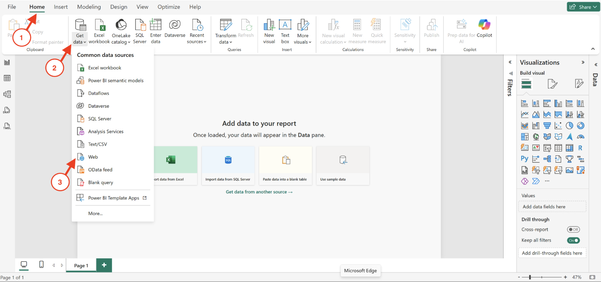
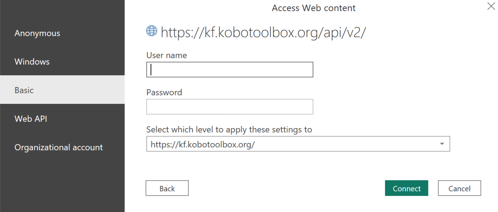
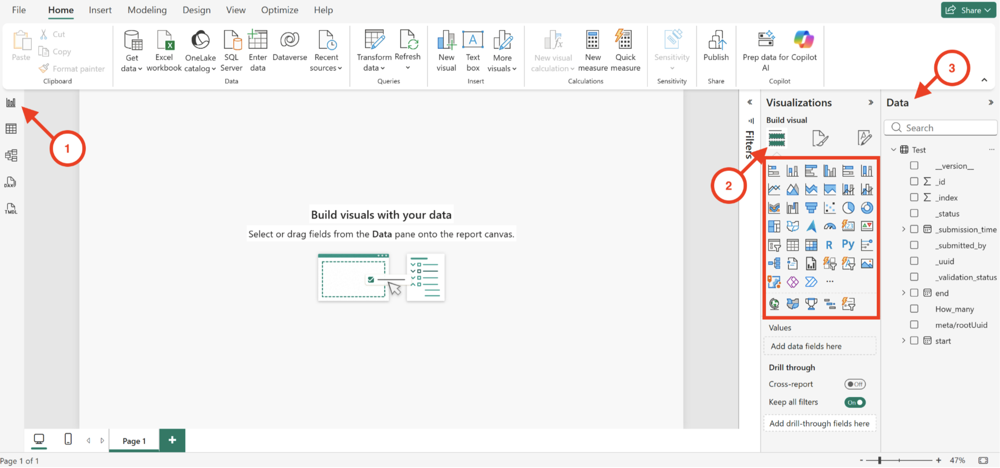
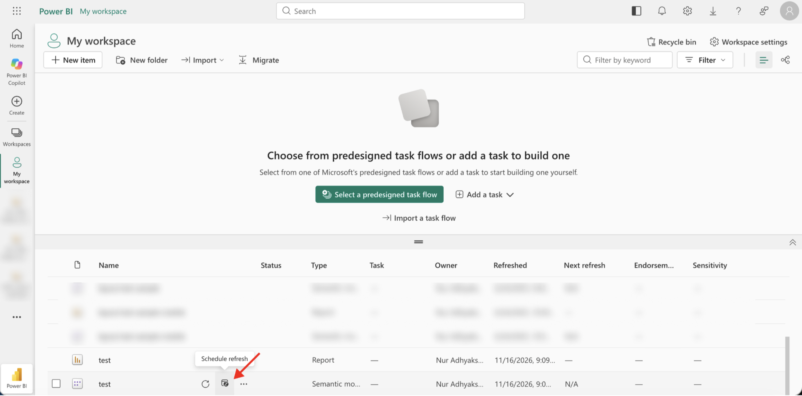

# Connecting KoboToolbox data to Microsoft Excel and Power BI
**Last updated:** <a href="https://github.com/kobotoolbox/docs/blob/8d2eb236f6c7515cc51164d5050a66dcb579e1aa/source/connect_excel_powerbi.md" class="reference">19 Nov 2026</a>

KoboToolbox allows you to connect project data directly to **Microsoft Excel** and **Power BI** using the KoboToolbox <a href="https://support.kobotoolbox.org/api.html" class="reference">Application Programming Interface (API)</a>. This allows you to retrieve updated submissions for analysis, reports, and dashboards without manually downloading new data files.

**Microsoft Excel** is a spreadsheet application for organizing and analyzing data, while **Power BI** is a business intelligence application for creating interactive reports and dashboards.

Both applications support <a href="https://support.kobotoolbox.org/synchronous_exports.html" class="reference">synchronous export links</a> to connect to KoboToolbox. Once connected, you can refresh your data to retrieve new submissions, edits, and other changes made to your project.

This article covers connecting KoboToolbox data to Excel and Power BI, preparing imported data, refreshing your connection, and troubleshooting common issues.

  <strong>Note:</strong> The steps in this article are intended for Windows users. Power BI Desktop is only available for Windows, and the web data connection features described here are designed for Excel on Windows. Excel for Mac supports Power Query, but some connection options and features differ.

## Retrieving your synchronous export link

Before connecting KoboToolbox to Excel or Power BI, you need a **synchronous export link** for your project.

A synchronous export link allows external applications to retrieve project data in CSV or XLSX format using saved export settings. The link remains the same over time, but the data is updated when the external application refreshes its connection.

  To generate and retrieve your link, follow the instructions in <a href="https://support.kobotoolbox.org/synchronous_exports.html" class="reference">Using the API for synchronous exports</a>.

## Connecting KoboToolbox to Excel or Power BI

Excel and Power BI use **Power Query** to connect to external data sources. The connection process is similar in both applications, with some differences in how you access and load the data.

### Adding the data source

To connect your KoboToolbox project:

1. Open Microsoft Excel or Power BI Desktop.
   - In **Excel**, open a blank workbook or an existing workbook.
   - In **Power BI Desktop**, open a blank report or an existing report.
2. Open the web data connector:
   - In **Excel**, go to **Data > Get Data > From Other Sources > From Web**.
   - In **Power BI**, go to **Home > Get data > Web**.
3. Select **Basic** in the web connection window, if prompted to choose a URL entry method.
4. Paste the synchronous export link you retrieved from KoboToolbox.
5. Click **OK**.

### Authenticating your connection

If your KoboToolbox project is private, you must authenticate the connection to access its data.

1. In the authentication window, select **Basic** as the authentication method.
2. Enter your KoboToolbox username and password.
3. Select the appropriate URL level for applying your credentials.
4. Click **Connect**.

Excel or Power BI will then connect to your KoboToolbox project and retrieve the available data.

  <strong>Note:</strong> If your project is public, you can select <b>Anonymous</b> instead of Basic authentication. However, <a href="https://support.kobotoolbox.org/project_sharing_settings.html#making-your-project-public" class="reference">making a project public</a> allows anyone with the appropriate link to access its submissions.

### Selecting and loading your data

Once connected, Excel or Power BI will display your data in the **Navigator** or **Power Query Editor**, depending on the export format and how the data is recognized.

If you are using an XLSX export, your project data may appear as multiple tables or sheets. If applicable, each repeat group is included in a separate sheet.

To prepare your data:

1. Select the table or sheet you want to import. If available, enable **Select multiple items** to import more than one table.
2. Click **Transform Data** to open the Power Query Editor.
3. Review the imported data and make any necessary adjustments, such as:
   - Removing unnecessary columns.
   - Renaming columns.
   - Changing data types.
   - Filtering records.
   - Expanding nested columns or converting structured data into tables, if needed.
4. When your data is ready:
   - In **Excel**, click **Close & Load** to load the data into your workbook.
   - In **Power BI**, click **Close & Apply** to load the data into your report.

You can now use the imported data to create tables, charts, reports, and dashboards.

<strong>Note:</strong> Before building visuals, check the validation and submission fields in Power Query. Filter out records that are not yet validated, check _submission_time is set as Date/Time, and check for duplicate _uuid values. Building visuals before this check can show unvalidated or duplicate submissions in your dashboard.

  <strong>Note:</strong> You can connect multiple KoboToolbox projects to the same Excel workbook or Power BI report. Repeat the connection process for each project using its synchronous export link.

## Working with imported data

After importing your KoboToolbox data, you can use the available tools in Excel or Power BI to analyze and visualize your results.

### Working with data in Excel

Excel allows you to organize imported data into tables and create summaries using PivotTables and PivotCharts.

If your data was loaded into the Power Query connection without appearing in a worksheet, you can load it manually:

1. Go to **Data > Queries & Connections**.
2. Right-click the query you want to load.
3. Select **Load To…**.
4. Choose **Table** and select the worksheet where you want to display the data.
5. Click **OK**.

You can also use PivotTables to summarize your project data:

1. Go to the **Insert** tab.
2. Select **PivotTable**.
3. Choose **From External Data Source**.
4. In the window that appears, select **Choose Connection**.
5. Select the connection associated with the query you created.
6. Choose where you want to place the PivotTable and click **OK**.

Use the **PivotTable Fields** pane to select the variables you want to analyze.

  For more information about creating PivotTables, see <a href="https://support.microsoft.com/en-us/excel" class="reference external">Microsoft's Excel documentation</a>.

### Working with data in Power BI

Power BI allows you to build interactive reports and dashboards using your imported KoboToolbox data.

After loading your data:

1. Open the **Report** view.
2. Select a visualization type, such as a bar chart, table, or map.
3. Add fields from your imported KoboToolbox data.
4. Customize the visualization as needed.

If your project includes multiple tables, such as repeat group data, you may need to establish relationships between them before combining their fields in visualizations.

To manage table relationships, go to **Model** view and create relationships using the appropriate identifiers.

## Refreshing your data

When new submissions are received or existing records are edited or deleted in KoboToolbox, you need to **refresh your connection** in Excel or Power BI to retrieve the updated data.

Refreshing retrieves the latest available export from KoboToolbox without requiring you to generate a new export link.

### Refreshing data in Excel

To refresh your data manually:

1. Open your Excel workbook.
2. Go to the **Data** tab.
3. Click **Refresh All** to update your connected queries.

You can also configure some Power Query connections to refresh when the workbook opens or at regular intervals through the connection properties.

### Refreshing data in Power BI

To refresh your data manually in Power BI Desktop:

1. Open your Power BI report.
2. Go to the **Home** tab.
3. Click **Refresh**.

Power BI will retrieve the latest available data from your KoboToolbox connection.

You can also **configure scheduled refreshes** through the Power BI service after publishing your report. To configure scheduled refreshes in Power BI:

1. In Power BI Desktop, go to the **Home** tab and click **Publish** to publish your report.
2. Open the <a href="https://app.powerbi.com" class="reference external">Power BI service</a> and sign in using the same account you used to publish the report.
3. Go to **Workspaces** and open the workspace containing your published report.
4. In the workspace, find the item with the same name as your report and **Semantic model** in the **Type** column.
5. Click the **Schedule refresh** icon next to the semantic model to open its refresh settings.
6. Configure the data source credentials, if required.
7. Under **Refresh**, enable scheduled refresh, select the refresh frequency, and set your preferred refresh times.
8. Click **Apply** to save your settings.

The number of scheduled refreshes available depends on your Power BI license and capacity. For example, Power BI Pro supports up to eight scheduled refreshes per day.

  <strong>Note:</strong> Synchronous exports are cached for up to five minutes, so new submissions may not appear immediately after refreshing. Refreshing Excel or Power BI does not bypass this interval.

## Troubleshooting

<strong>Unable to connect to KoboToolbox</strong>

 
If Excel or Power BI cannot connect to your project, check that:
<ul>
  <li>You are using the correct synchronous export link.</li>
  <li>Your KoboToolbox username and password are correct.</li>
  <li>Your account has permission to view the project's submissions.</li>
  <li>You selected the appropriate authentication method.</li>
</ul>
If you previously connected to KoboToolbox using another account on the same server, Excel or Power BI may be using stored credentials from the earlier connection.
  
To update your credentials:
<ol>
  <li>Open <strong>Data source settings</strong>:
    <ul>
      <li>In <strong>Excel:</strong> Go to <strong>Data &gt; Get Data &gt; Data Source Settings</strong>.</li>
      <li>In <strong>Power BI Desktop:</strong> Go to <strong>File &gt; Options and settings &gt; Data source settings</strong>, or <strong>Home &gt; Transform data &gt; Data source settings</strong>.</li>
    </ul>
  </li>
  <li>Select the KoboToolbox connection.</li>
  <li>Click <strong>Edit Permissions</strong> to update the credentials, or <strong>Clear Permissions</strong> to remove the saved credentials.</li>
  <li>Reconnect using the correct KoboToolbox account.</li>
</ol>

 

<strong>Unable to refresh data</strong>

 
If your connection works initially but fails when refreshing, possible causes include:
<ul>
  <li><strong>Changed credentials:</strong> Your KoboToolbox password or authentication settings may have changed. Update your credentials in the data source settings.</li>
  <li><strong>Changes to the form:</strong> Questions may have been renamed or deleted, affecting the structure of the imported data. Open the Power Query Editor and review the affected steps.</li>
  <li><strong>Data type errors:</strong> Changes to question types or imported column formats may cause errors. Review and adjust the column data types in Power Query.</li>
  <li><strong>Export limitations:</strong> Large projects may exceed the synchronous export processing limit. Consider filtering submissions or excluding unnecessary fields in your saved export settings.</li>
</ul>

 

<strong>Missing repeat group data</strong>

 
If your project contains repeat groups but the data does not appear in Excel or Power BI, check that you are using the XLSX synchronous export link.
  
CSV exports do not include repeat group data. XLSX exports include repeat groups as separate sheets, which must be imported and linked to the main submission data when needed.

 

<strong>Data is not updating</strong>

 
If new submissions do not appear after refreshing:
<ol>
  <li>Confirm that the submissions are visible in your KoboToolbox project.</li>
  <li>Check whether filters in your saved export settings exclude the new submissions.</li>
  <li>Allow at least five minutes for the synchronous export cache to update.</li>
  <li>Refresh the connection again in Excel or Power BI.</li>
</ol>
If you are using scheduled refresh in Power BI, also check the refresh history for errors and confirm that the schedule is enabled.

