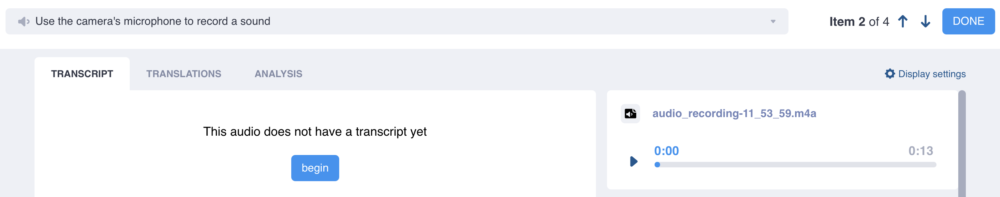
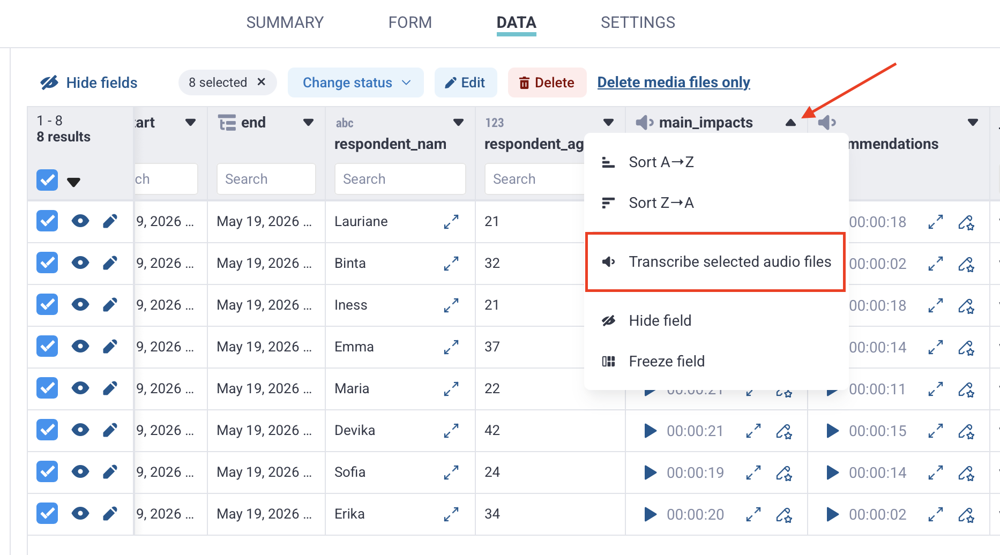

# Transcribing audio responses
**Last updated:** <a href="https://github.com/kobotoolbox/docs/blob/eaaa0a122cb15511b64a66babaa5dad10f6aa7a9/source/transcription-translation.md" class="reference">6 Oct 2026</a>

<iframe src="" style="width: 100%; aspect-ratio: 16 / 9; height: auto; border: 0;" title="YouTube video player" frameborder="0" allow="accelerometer; autoplay; clipboard-write; encrypted-media; gyroscope; picture-in-picture; web-share" allowfullscreen></iframe>

KoboToolbox’s natural language processing tools include automatic transcription using automated speech recognition (ASR), which can convert audio responses into text for review, translation, and [analysis](https://support.kobotoolbox.org/qualitative_analysis.html).

You can transcribe individual audio responses or process multiple submissions in bulk from the data table. This article explains how to transcribe audio responses manually or automatically, review completed transcripts, and manage transcription usage limits.

<strong>Note:</strong> Automatic transcription is not available for all languages. For unsupported languages, you can transcribe audio responses manually.

## Collecting audio responses

Before transcribing audio responses, you need to collect audio data in your project.

1. Add an **Audio** question to your form or enable [background audio recording](https://support.kobotoolbox.org/qualitative_data.html#recording-interviews-with-background-audio-recordings).
2. Deploy the form.
3. Collect submissions containing audio recordings.

<strong>Note:</strong> For some supported languages, automatic transcription may not work for audio files longer than 50 minutes. For long interviews, consider using multiple audio questions instead of a single background audio recording.

## Transcribing individual audio files

To transcribe an individual audio response:

1. Open your project and go to **DATA > Table.**
2. Click <i class="ti-outline ti-pencil-star"></i> **Open** next to the audio response you want to transcribe.
3. In the **TRANSCRIPT** tab, click **begin.**
    - Select the original language of the audio recording.
    - If available, select **automatic** to generate the transcript automatically. Select **manual** to transcribe the recording yourself.
    - If using automatic transcription, select the closest regional variant available and click **create transcript.**
4. Review the completed transcript and make any necessary edits.
    - You can play the audio recording in the top right corner to check the transcript against the recording.
5. Click **Save.**
6. When finished, click **DONE**, use the arrows to move to another submission, or continue to the **TRANSLATIONS** tab.

When you return to the data table, the transcript appears in a new column and can be [downloaded](https://support.kobotoolbox.org/export_download.html) alongside your survey data. After completing a transcript, you can translate it into one or more languages and/or [analyze](https://support.kobotoolbox.org/qualitative_analysis.html) it.

<strong>Note:</strong> Automatically generated transcripts must be saved to prevent data loss. Navigating away from the page without saving may result in losing the transcript.

## Transcribing audio files in bulk

You can automatically transcribe audio recordings from multiple submissions at once.

To transcribe audio responses in bulk:
1. Open your project and go to **DATA > Table.**
2. Select the submissions you want to transcribe using the checkboxes on the left.
3. In the column containing the audio recordings, click the arrow in the column header.
4. Click **Transcribe selected audio files.**
5. Select the language and region.
6. Click **Start transcription.**

Bulk transcription runs in the background, so you can continue working in other parts of KoboToolbox while it is processing. Completed transcripts are added to a new column in the data table and marked as ready for review.

If the selected submissions exceed your remaining transcription limit, you may need to select fewer rows before starting the bulk transcription.

## Reviewing and approving transcripts

Always review automatically generated transcripts to confirm that they accurately reflect the audio recordings before using them for analysis or translation.

To review and approve an individual transcript generated from bulk transcription:
1. Click **Review.**
2. Make any necessary edits.
3. Save the transcript and move to the next submission.

To approve multiple transcripts at once:
1. Select the relevant submissions using the checkboxes on the left.
2. In the transcript column, click the arrow in the column header.
3. Click **Approve all selected.**

## Supported languages for transcription

KoboToolbox supports automated speech recognition (ASR) for supported languages and regional variants. ASR capabilities are provided by Google Cloud Compute, which currently offers automatic transcription in 112 languages (with 142 regional variants).

<strong>Note:</strong> Audio files are sent to the external transcription service only for the time required to process them. They are not stored by the service after processing or used to improve the service.

For manual transcription, you can select from approximately 7,000 living languages based on the ISO 639-3 list maintained by SIL International.

<strong>Note:</strong> When manually transcribing an audio response, it is still necessary to select the correct language, otherwise subsequent automatic translations may be inaccurate.

If you cannot find a language in the list, try searching for an alternative spelling or name. Language names are listed in English. Some languages may also be listed under an alternative name.

  For a full list of supported languages for automatic transcription, see <a href="https://docs.google.com/spreadsheets/d/1_QDcORZd9qXgfq1OBb61U6ondYfjwmHXOv4XZPjxVVw/edit?usp=sharing">Languages supported for automatic transcription and translation</a>.

## Usage limits for automatic transcription

Community Plan users can use up to **10 minutes of automatic transcription** per month. Automatic transcription counts towards this limit whether audio files are **processed individually or in bulk.**

If you need additional transcription capacity, you can [upgrade](https://www.kobotoolbox.org/pricing/) to a plan with a higher quota or purchase a Natural Language Processing (NLP) Package [add-on](https://support.kobotoolbox.org/account_settings.html#add-ons). You can also continue transcribing audio responses manually without a usage limit.

## Troubleshooting

    
<strong>Long audio files are not being transcribed</strong>

    For some supported languages, automatic transcription may not work for audio files longer than 50 minutes.  
For long interviews, consider using multiple Audio questions instead of a single background audio recording. Shorter recordings can also be easier to upload, manage, and review.  
If you already have a long recording, you can download the audio file, split it into shorter files, and upload the files back to KoboToolbox for transcription.

